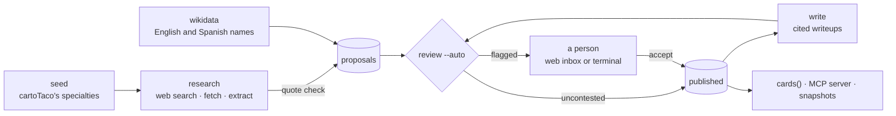

# cocina

A curated knowledgebase of Mexican food, in which every fact says where it came from.

cocina holds small, checkable **claims** about dishes, salsas, chiles, cuts and techniques: *birria originates in Jalisco*, *a gringa uses a flour tortilla*. Each claim is backed by a short quote from a **credited source**, meaning a named author or publisher. Claims are published only through a reviewed gate. On top of the claims sit short **writeups**, a few plain sentences per food, and every sentence cites the claims it states.

Consumers read published knowledge only. The first is [cartoTaco](https://github.com/keatonwilson/cartoTaco), whose concierge answers "what is chavindeca?" from cocina and shows the sources under its reply. Its spot cards show cocina's cited descriptions too.

As of snapshot `kb-2026.10.28.2`: **76 foods, 1271 claims, 71 writeups.**

## How knowledge gets in



1. **Seed.** cartoTaco's spec tables (specialties, protein styles, salsas) and its menu categories become *proposed* entities. Their old descriptions are kept only as hints, never as evidence.
2. **Research.**
   - Claude searches the web for an entity and picks reliable pages.
   - cocina fetches them itself. It respects `robots.txt` and `noai` opt-outs.
   - Claude then extracts claims, each with an exact quote.
   - A claim is dropped unless its quote appears word for word on the page that was fetched.
3. **Auto-review.** Claude checks each entity's proposals against its published facts and against each other. It flags a proposal whose quote doesn't actually state it, or that contradicts another fact. Code also flags, whatever the model says:
   - a fact a person rejected or retired, if research proposes it again;
   - a name that belongs to another entry.

   Everything unflagged is published. On the first full run, about 1 proposal in 8 was flagged.
4. **People** decide what's flagged, in the web inbox (`/review`) or the terminal, and can retire anything already published.
5. **Writeups.**
   - Claude writes 2–4 sentences from an entity's published claims only.
   - Code refuses any sentence that cites nothing, cites a claim the entity doesn't have, or copies 8 or more consecutive words of a quote.
   - Auto-review then checks each sentence against the claims it cites.

## The rules the database enforces

These are Postgres constraint triggers, checked when each change commits. No script can skip them.

- **Credit:** a published claim needs at least one published quote from a credited source, one with a named author or publisher. If its only creator opted out (`do_not_use`), the claim isn't served.
- **Entities:** a published entity needs a published claim, and a link between entities (*chavindeca is a variant of sincronizada*) needs the other entity published too.
- **Writeups:** every sentence of a published writeup must cite its entity's own published, credited claims. If one of those claims loses its credit, the writeup stops being served.
- **The one gate:** `accept_proposal` is the only way anything is published, and `retire` is the only way anything comes down. Nothing is deleted.

Reads such as `cards()`, `get_entity()` and the anonymous REST API return published, credited rows only.

## Using it

- **MCP server:** `https://cocina-tau-six.vercel.app/mcp` (Streamable HTTP, read-only, bearer token for now). It has four tools: `search`, `get_entity`, `related` and `sources`. Every answer carries `kb_version`, the time of the last accepted change.
  ```
  claude mcp add -s user --transport http cocina https://cocina-tau-six.vercel.app/mcp \
    --header "Authorization: Bearer <token>"
  ```
- **Snapshots:** each [release](https://github.com/keatonwilson/cocina/releases) attaches `kb-YYYY.MM.DD.jsonl`, one published card per line. Consumers pin a tag, so changes to the knowledge never make their tests flaky. cartoTaco's evals do this.

## Running it

You need Python 3.12, Node 22+ with pnpm, the Supabase CLI and Docker. Copy `.env.example` to `.env`; the pipeline (`pipeline/.env`) and the app share it.

```sh
supabase start                                    # local Postgres + REST, migrations applied
cd pipeline && python3.12 -m venv .venv && .venv/bin/pip install -r requirements.txt
cd ../app && pnpm install
```

| Command (from `pipeline/`) | What it does |
|---|---|
| `python -m cocina.seed [--add KIND NAME]` | Proposed entities from cartoTaco, or one by hand |
| `python -m cocina.research <slug>…` | Search, fetch, extract and quote-check, then write proposals (about $0.17 an entity) |
| `python -m cocina.wikidata <slug>… \| --all` | Other English and Spanish names from Wikidata (CC0) |
| `python -m cocina.write <slug>… \| --all` | Cited writeups from published claims (about $0.004 each) |
| `python -m cocina.review --auto` | Publishes uncontested proposals and flags the rest |
| `python -m cocina.review` | A person decides what's open, in the terminal |
| `python -m cocina.retire <ids> \| --entity slug [--into slug] --why …` | Takes published claims, or a duplicate entity, down |
| `python -m cocina.snapshot [--release]` | Writes the JSONL snapshot, and optionally a GitHub release |

**Tests:**
- `supabase test db` runs the pgTAP suites for the citation rules, writeups and retire.
- `cd pipeline && .venv/bin/pytest` covers quotes, grouping, fetch, robots, auto-review, writeups and Wikidata.
- `cd app && pnpm check && pnpm test` runs the type check and app tests. CI also builds the app and loads its pages.

**Deploys:**
- Merging a migration to `main` applies it to the production database (`migrate.yml`).
- The app (`app/`, the inbox and MCP server) deploys on Vercel.
- Sign-in setup for the hosted project is described in [CLAUDE.md](CLAUDE.md).

## Repository

```
supabase/    migrations (schema, citation rules, read functions), pgTAP tests, auth email template
pipeline/    Python: seed, research, wikidata, write, review, retire, snapshot
app/         SvelteKit on Vercel: the MCP server (/mcp) and the review inbox (/review)
docs/        PLAN.md, the phase plan
CLAUDE.md    working notes for people and agents: data model, rules, conventions
```

## Sources and opt-outs

- **Quotes:** cocina quotes little, at most 400 characters per piece of evidence and usually one sentence, and always credits the author or publisher.
- **Fetching:** it honours `robots.txt` and `noai` signals. The one exception is Wikidata's documented API, which the owner approved explicitly; it uses CC0 data.
- **Opting out:** if you wrote something cocina cites and would rather it didn't, open an issue. Marking a creator `do_not_use` takes their work out of every read straight away.

## License

None has been chosen yet; whether published knowledge goes public, and under what license, is still an open decision. Until then, all rights are reserved for the code and the data.
